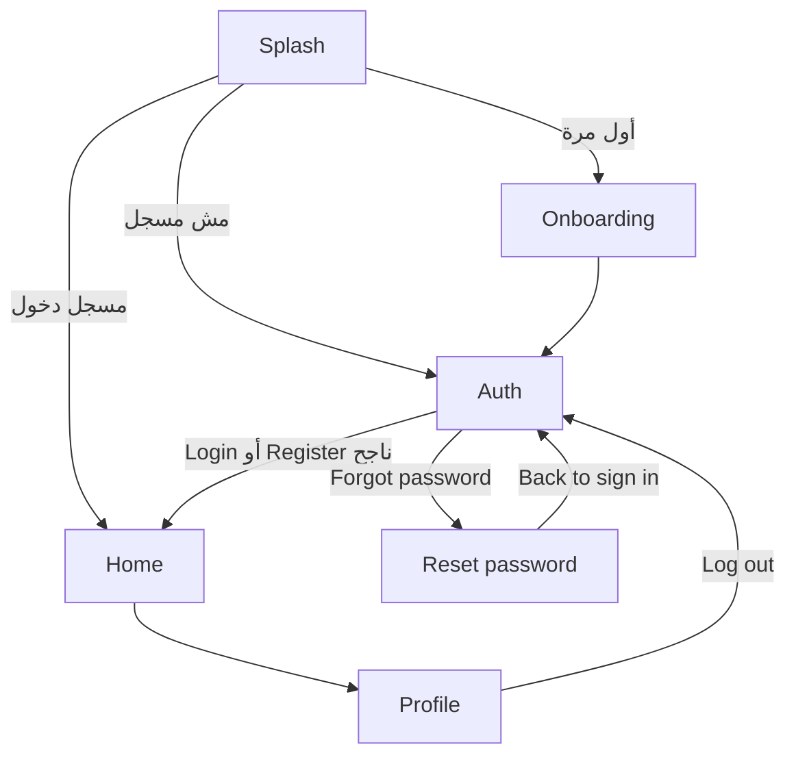

# توثيق جزء تسجيل الدخول والبروفايل (Auth & Profile)

**المشروع:** Decora، تطبيق Flutter لمتجر أثاث بالواقع المعزز
**المسؤولة عن الجزء ده:** سارة
**آخر تحديث:** 28/11/2026

الملف ده بيشرح الجزء اللي اشتغلت عليه سارة: شاشة تسجيل الدخول (Auth)، شاشة الملف الشخصي (Profile)، والـ `AuthProvider` المربوط بـ Firebase Authentication، مع خطة الاختبار ونتايجها.

---

## 1. نظرة عامة

| الجزء | الوصف |
|---|---|
| شاشة Auth | تسجيل دخول، إنشاء حساب، ونسيت الباسورد، في شاشة واحدة بـ 3 خطوات |
| شاشة Profile | بيانات المستخدم، إحصائيات (طلبات / مفضلة / AR)، قايمة الاختصارات، وتسجيل الخروج |
| `AuthProvider` | بيربط التطبيق بـ Firebase Authentication، وبيحفظ بيانات المستخدم في Firestore |
| الاختبارات | 19 اختبار تلقائي لشاشة Auth + اختبار يدوي من 10 حالات |

---

## 2. الملفات

| الملف | الوظيفة |
|---|---|
| `lib/features/auth/auth_screen.dart` | شاشة Auth بخطواتها الثلاثة (Login / Register / Forgot password) |
| `lib/features/profile/profile_screen.dart` | شاشة Profile |
| `lib/providers/auth_provider.dart` | منطق تسجيل الدخول والربط مع Firebase |
| `test/auth_screen_test.dart` | اختبارات الـ Widget لشاشة Auth |
| `assets/images/logo.png` | لوجو Decora اللي بيظهر في شاشة Auth |

---

## 3. شاشة Auth

### 3.1 الخطوات

الشاشة (`AuthScreen`) فيها 3 خطوات، وكل خطوة بتطابق فريم في Figma:

| الخطوة | العنوان | المحتوى |
|---|---|---|
| Login | Make yourself at home | إيميل، باسورد، Forgot password?، زرار **Login**، Continue with Google، رابط Register |
| Register | Create your account | اسم، إيميل، باسورد، تأكيد الباسورد، زرار **Register**، Continue with Google، رابط Login |
| Forgot password | Reset your password | إيميل، زرار Send Reset Link، رابط Back to sign in |

### 3.2 قواعد التحقق (Validation)

| الحقل | القاعدة | الرسالة |
|---|---|---|
| الاسم | مش فاضي | Please enter your name |
| الإيميل | مش فاضي، وشكله صحيح | Please enter your email / Please enter a valid email |
| الباسورد | مش فاضي، و8 حروف على الأقل (في Login و Register) | Please enter your password / At least 8 characters |
| تأكيد الباسورد | يطابق الباسورد | Passwords do not match |

الإيميل والاسم بيتعمل لهم `trim()` قبل الإرسال لـ Firebase.

### 3.3 حالات الشاشة

- **Loading:** الزرار الأساسي بيعرض مؤشر تحميل، والحقول بتتقفل لحد ما العملية تخلص.
- **Error:** رسالة خطأ حمرا تحت الحقول (من `AuthProvider.lastError`).
- **Success:** في Login و Register بيروح لـ Home. في Forgot password بتظهر رسالة خضرا: *Reset link sent. Please check your inbox.*

### 3.4 التنقل



كمان `AuthScreen` نفسها بتتأكد في `initState` لو المستخدم لسه مسجّل، وبتنقله لـ Home على طول.

---

## 4. AuthProvider

الملف: `lib/providers/auth_provider.dart`، وهو `ChangeNotifier` متسجّل في `main.dart`.

### 4.1 الأعضاء

الأسماء دي **متفق عليها مع باقي الفريق ومش بتتغير**:

| العضو | النوع | الوظيفة |
|---|---|---|
| `isLoggedIn` | `bool` | هل فيه مستخدم مسجّل دخول |
| `userName` | `String` | الاسم (لو مفيش اسم بنعرض الجزء اللي قبل @ من الإيميل) |
| `email` | `String` | الإيميل |
| `signIn(email, password)` | `Future<bool>` | تسجيل الدخول |
| `register(name, email, password)` | `Future<bool>` | إنشاء حساب جديد |
| `signOut()` | `void` | تسجيل الخروج (بيمسح الحالة فوراً) |

الإضافات الجديدة (من غير ما تكسر القديم):

| العضو | النوع | الوظيفة |
|---|---|---|
| `uid` | `String` | رقم المستخدم الفريد في Firebase (فاضي لو مفيش مستخدم) |
| `lastError` | `String?` | آخر رسالة خطأ واضحة للمستخدم |
| `sendPasswordReset(email)` | `Future<bool>` | بعت لينك إعادة الباسورد على الإيميل |

للاستخدام من أي شاشة:

```dart
final uid = context.read<AuthProvider>().uid;
```

### 4.2 طريقة العمل

- **signIn:** `signInWithEmailAndPassword`.
- **register:** `createUserWithEmailAndPassword`، وبعدها تسجيل الاسم (`updateDisplayName`)، وكتابة بيانات المستخدم في Firestore. لو كتابة Firestore فشلت، الحساب نفسه بيفضل متعمل ومش بيفشل التسجيل.
- **المستخدم يفضل مسجّل:** الـ Provider بيسمع لـ `authStateChanges()` وبيحدّث الحالة، وكمان الـ Splash بيقرا الحالة عشان يقرر يروح فين.
- الـ Provider بيقبل `FirebaseAuth` و `FirebaseFirestore` اختياريين في الـ constructor، عشان نقدر نبدّلهم في الاختبارات.

### 4.3 بنية البيانات في Firestore

المسار: `users/{uid}`

| الحقل | المحتوى |
|---|---|
| `name` | اسم المستخدم |
| `email` | الإيميل |
| `createdAt` | وقت إنشاء الحساب (server timestamp) |

### 4.4 رسائل الأخطاء

| كود Firebase | الرسالة للمستخدم |
|---|---|
| `invalid-email` | Please enter a valid email. |
| `invalid-credential` / `wrong-password` / `user-not-found` (في Login) | Email or password is incorrect. |
| `user-not-found` (في Reset) | No account found with this email. |
| `email-already-in-use` | This email is already registered. Try logging in. |
| `weak-password` | Password is too weak. Use at least 8 characters. |
| `network-request-failed` | No internet connection. Please check your network and try again. |
| `too-many-requests` | Too many attempts. Please wait a moment and try again. |
| `user-disabled` | This account has been disabled. |
| `operation-not-allowed` | Email sign-in is not enabled yet. Please contact the team. |
| أي حاجة تانية | Something went wrong. Please try again. |

ملحوظة: Firebase الجديد ممكن يرجّع `invalid-credential` للإيميل الغلط والباسورد الغلط مع بعض، عشان كده الرسالة واحدة.

---

## 5. شاشة Profile

الملف: `lib/features/profile/profile_screen.dart`

| الجزء | المحتوى |
|---|---|
| الحالة: مش مسجّل | شاشة فاضية (`EmptyView`) فيها "You are not logged in" وزرار Login |
| الهيدر | زرار رجوع، عنوان Profile، زرار Edit (Coming soon) |
| الأفاتار | أول حروف الاسم (مثلاً AW)، والاسم والإيميل من `AuthProvider` |
| الإحصائيات | **Orders** من `OrdersProvider`، **Saved** من `FavoritesProvider`، **AR shots** قيمة مؤقتة `0` |
| القايمة | My orders ← `AppRoutes.orders`، My AR shots ← `AppRoutes.arShots`، Settings ← `AppRoutes.settings`، Help & support ← Coming soon |
| Log out | بينادي `AuthProvider.signOut()` وبعدها `AppRoutes.auth` |

---

## 6. المكتبات المستخدمة

| الباكدج | الاستخدام |
|---|---|
| `firebase_core` | تهيئة Firebase |
| `firebase_auth` | تسجيل الدخول والحسابات |
| `cloud_firestore` | حفظ بيانات المستخدم |
| `provider` | إدارة الحالة (`AuthProvider`) |
| `go_router` | التنقل بين الشاشات |
| `flutter_screenutil` | المقاسات المتجاوبة (`.w .h .r .sp`) |

---

## 7. إعداد Firebase المطلوب

الأمور دي بتتعمل من Firebase Console (مسؤولية الليدر):

1. تفعيل **Email/Password** في Authentication ← Sign-in method.
2. **قواعد Firestore (Rules)** تسمح للمستخدم يكتب `users/{uid}` الخاص بيه بس.

> **ملحوظة:** تفعيل Email/Password اتأكد عملياً لأن التسجيل نجح. أما كتابة `users/{uid}` فلسه ما اتأكدش منها من الـ Console.

---

## 8. تشغيل المشروع والاختبارات

```powershell
git checkout develop
git pull
flutter pub get
flutter run -d emulator-5554
```

> Firebase معمول للـ Android و iOS فقط، فمش بيشتغل على Chrome أو Windows.

تشغيل اختبارات شاشة Auth:

```powershell
flutter test test/auth_screen_test.dart
```

لو ظهر خطأ إن فولدر `assets/images/products/` مش موجود، اعمليه محلياً (فولدر فاضي):

```powershell
New-Item -ItemType Directory -Force assets\images\products
```

---

## 9. الاختبار

### 9.1 اختبار يدوي (Android Emulator، 27/11/2026)

| # | الحالة | النتيجة المتوقعة | النتيجة |
|---|---|---|---|
| 1 | Login بباسورد أقل من 8 حروف | At least 8 characters، ومفيش دخول | ✅ نجح |
| 2 | تسجيل حساب جديد | الدخول على Home | ✅ نجح |
| 3 | فتح Profile | ظهور الاسم والإيميل الصحيحين | ✅ نجح |
| 4 | Log out | الرجوع لشاشة Login | ✅ نجح |
| 5 | Login بنفس الحساب | الدخول على Home | ✅ نجح |
| 6 | Login بباسورد غلط | Email or password is incorrect. | ✅ نجح |
| 7 | تسجيل بإيميل مستخدم قبل كده | This email is already registered… | ✅ نجح |
| 8 | Forgot password | رسالة نجاح ووصول إيميل الإعادة | ✅ نجح |
| 9 | قفل التطبيق وفتحه | الدخول على Home من غير تسجيل | ✅ نجح |
| 10 | Airplane mode ثم Login | No internet connection… | ✅ نجح |

### 9.2 اختبارات تلقائية (`test/auth_screen_test.dart`)

الاختبارات بتستخدم `FakeAuthProvider` بدل Firebase، فبتشتغل من غير إنترنت. **النتيجة: 19 من 19 نجحوا.**

| المجموعة | عدد الاختبارات | بتغطي |
|---|---|---|
| Login screen | 7 | النصوص، حقول فاضية، إيميل غلط، باسورد أقل من 8، دخول ناجح مع trim للإيميل، دخول فاشل بيعرض الخطأ، مستخدم مسجّل بيروح Home |
| Register screen | 7 | النصوص ومن غير Forgot password، الرجوع لـ Login، باسورد مش متطابق، باسورد قصير، اسم فاضي، تسجيل ناجح، تسجيل فاشل |
| Forgot password | 5 | من غير خطوات OTP، إيميل غلط، إرسال ناجح، إرسال فاشل، الرجوع لـ Login |

> في الاختبارات، الخط الافتراضي (Ahem) أعرض من الخط الحقيقي، فبعض الصفوف بتطلع "overflow" في الاختبار بس. الاختبارات بتتجاهل أخطاء الـ overflow بس، وأي خطأ تاني بيفشّل الاختبار.

---

## 10. ملاحظات ومحدودية حالية

- زرار **Continue with Google** لسه بيعرض "Coming soon" (محتاج `google_sign_in` و SHA-1).
- **AR shots** في Profile قيمة مؤقتة `0` لحد ما يبقى فيه مصدر بيانات.
- **Edit** و **Help & support** في Profile بيعرضوا "Coming soon".
- الخط **Inter** المستخدم في Figma مش متسجل في المشروع، والخط المستخدم Tajawal.
- لون زرار Log out هو `AppColors.error` بدل اللون الأحمر الغامق في Figma، لأن اللون ده مش في `AppColors`.
- اختبارات شاشة **Profile** لسه ما اتكتبتش، لأنها محتاجة Providers تانية (الطلبات والمفضلة).